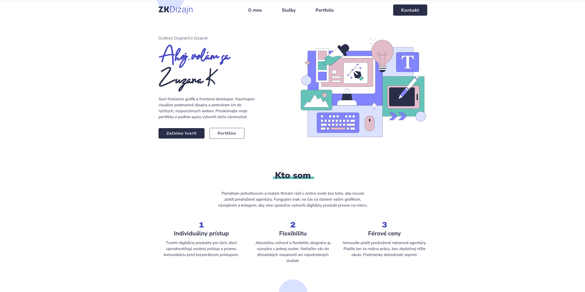

# ZKDizajn — Personal Portfolio Website

This is my personal freelance portfolio site, built from my own Figma design. Unlike my Frontend Mentor solutions, this is a real-world project — my actual business card online — but I held myself to the same standard throughout: same accessibility expectations, same code review rigor, same "would this survive a reviewer's feedback" mindset.

## Table of contents

- [Overview](#overview)
  - [What it does](#what-it-does)
  - [Screenshot](#screenshot)
  - [Links](#links)
- [My process](#my-process)
  - [Built with](#built-with)
  - [Features](#features)
  - [What I learned](#what-i-learned)
  - [Accessibility](#accessibility)
  - [Continued development](#continued-development)
  - [Running locally](#running-locally)
  - [AI Collaboration](#ai-collaboration)

## Overview

### What it does

ZKDizajn is a one-page portfolio site for my freelance graphic design and frontend work. Visitors can:

- Learn about me and the services I offer
- Browse my frontend development projects
- Browse my graphic design portfolio in an expandable, lightbox-enabled gallery
- Send me a message directly through a working contact form (no backend of my own required)

### Screenshot



### Links

- Live Site URL: [Add your live site URL here](https://zuzana83.github.io/freelancer-portfolio/)
- Repository: [Add your GitHub repo link here](https://github.com/Zuzana83/freelancer-portfolio)

## My process

### Built with

- Semantic HTML5 markup
- Vanilla CSS with custom properties, CSS Grid, and Flexbox
- Mobile-first, responsive workflow
- Vanilla JavaScript (ES modules, no frameworks)
- [fslightbox](https://fslightbox.com/) — lightweight lightbox library for the graphic design gallery
- [Formspree](https://formspree.io/) — handles contact form submissions without me needing to run my own backend
- `IntersectionObserver` — for scroll-triggered entrance animations

### Features

- Fully accessible mobile navigation with proper focus management (focus moves into the menu on open, back to the trigger button on close) and outside-click-to-close behavior
- A data-driven graphic design gallery: images live in a plain JS array of objects (not hardcoded HTML), rendered dynamically with an expand/collapse "show more" control
- A fully validated contact form, connected to a real third-party service (Formspree) via `fetch()`, with distinct handling for success, validation errors from the server, and network failures
- Scroll-triggered entrance animations for both the static and dynamically-generated content, sharing a single reusable `IntersectionObserver` instance
- Everything user-facing is in Slovak, since this is a real site for Slovak-speaking clients, not a Frontend Mentor exercise

### What I learned

**Integrating an external library (fslightbox).** My graphic design portfolio needed a lightbox, and rather than building one from scratch, I used fslightbox — my first time wiring a third-party JS library into my own code rather than writing everything myself. The tricky part wasn't the initial setup; it was that fslightbox scans the DOM *once*, when the script first loads, looking for anything marked with `data-fslightbox`. My gallery images aren't in the HTML at all — they're injected by my own JavaScript from a data array, after the page has already loaded. That meant fslightbox had already finished looking for images by the time mine existed, so clicking them did nothing.

The fix was calling the library's own `refreshFsLightbox()` function every time I inject new images, telling it to rescan the DOM:

```js
function loadGraphicPortfolio(portfolioArr) {
    const html = portfolioArr.map(item => createGridItem(item)).join("");
    graphicPortfolioGridEl.insertAdjacentHTML("beforeend", html);
    refreshFsLightbox();
}
```

This taught me something that goes beyond this one library: any tool that scans the DOM on load needs to be told explicitly when *your* code changes that DOM afterward. It won't know on its own.

**Connecting the contact form to a real-world service (Formspree).** This was my first time sending data to an actual backend rather than just `console.log`-ing form values. I didn't let the browser handle the default form submission (which would redirect the page); instead I intercepted it with `e.preventDefault()` and sent the data myself with `fetch()`, so I could control exactly what the user sees at every step:

```js
const response = await fetch(e.target.action, {
    method: "POST",
    headers: { 'Accept': 'application/json', 'Content-Type': 'application/json' },
    body: JSON.stringify(requestData),
});
```

This forced me to actually think through three separate outcomes instead of one: the request succeeds, the request reaches Formspree but gets rejected (e.g. a validation issue Formspree itself catches), or the request never arrives at all (no internet connection). Each of those needed its own message, which I built using a `try`/`catch`/`finally` structure — `catch` for the network failure, an `if (!response.ok)` check inside `try` for a reachable-but-rejected response, and `finally` to guarantee the submit button gets re-enabled no matter which path was taken.

I also had to decide how my own JavaScript validation should coexist with the browser's built-in validation (`required`, `type="email"`, and so on). Since my JS already fully covers every field myself — empty checks, email format, message length — I added `novalidate` to the form so the browser doesn't also try to validate it and show its own native tooltips on top of mine. Two validation systems fighting over the same fields would have been confusing for the user; `novalidate` makes it clear my JavaScript is the single source of truth.

**Scroll-triggered animations with IntersectionObserver.** I wanted elements to fade/slide into view as the user scrolls down the page, for both the static project cards already in the HTML and the dynamically-generated graphic design images. `IntersectionObserver` is built exactly for this — instead of running expensive calculations on every scroll event, it watches elements and only calls your function when one actually enters the viewport:

```js
const slideInObserver = new IntersectionObserver(function(entries) {
    entries.forEach(entry => {
        if (entry.isIntersecting) {
            entry.target.classList.add("moved-in");
            slideInObserver.unobserve(entry.target);
        }
    });
}, { rootMargin: "0px 0px -40px 400px" });
```

I declared a single observer instance at the top level of my script and reused it for both the static cards and every batch of dynamically-loaded images — rather than creating a new observer every time the gallery loaded more content, which would have meant throwing away and recreating a perfectly good observer for no reason. Since the animation is meant to happen once, I call `unobserve()` the moment an element animates in, so it's never checked again.

The most important bug I caught here was accessibility-related, not a JavaScript bug at all — a CSS one. I have a `prefers-reduced-motion` media query meant to disable the animation for users who've set that OS-level preference. It wasn't working, and the cause was pure CSS source order: I'd placed the media query block *before* the plain `.pre-animation` rule it was supposed to override. Media queries carry no special priority in the cascade — a later plain rule in the file beats an earlier rule inside a media query, reduced-motion or not. Moving the media query to the end of the file, after the rules it needed to override, fixed it. I confirmed the fix by actually enabling reduced motion in my OS settings and testing it myself, rather than assuming the code was correct.

### Accessibility

- Mobile navigation traps focus sensibly: opening moves focus to the close button, closing returns it to the menu trigger
- All interactive elements have visible focus states
- Form inputs show accessible error messages, with `aria-invalid` set on invalid fields
- The expand/collapse gallery button uses `aria-expanded` and `aria-controls` so screen reader users know what it does and what it affects
- Images that depend on JavaScript to become visible (for the scroll animation) are never permanently hidden if JavaScript fails — the hidden state is applied *by* JavaScript, not baked into the base CSS
- Animations respect `prefers-reduced-motion`

### Continued development

- Fill in the live site link once published and add the final screenshot
- Revisit the popup message's backdrop/dimming behavior now that it's positioned at the top of the viewport instead of centered

### Running locally

This is a static site with no build step. Clone or download the files and open `index.html` in a browser, or serve the folder with any static server (e.g. the VS Code "Live Server" extension) since the JavaScript is loaded as an ES module (`type="module"`), which some browsers restrict when opened directly via `file://`.

### AI Collaboration

I used an AI tool as a mentor throughout this build, the same way I worked through my Frontend Mentor projects — holding this personal project to the same standard a reviewer would apply. I'd describe what I wanted in plain terms, write the implementation myself, test it, and report back what actually happened, then iterate from there. Debugging in particular (the fslightbox timing issue, the reduced-motion CSS ordering bug, several CSS masonry grid dead ends) came from working through *why* something wasn't working rather than being handed a fix outright.
